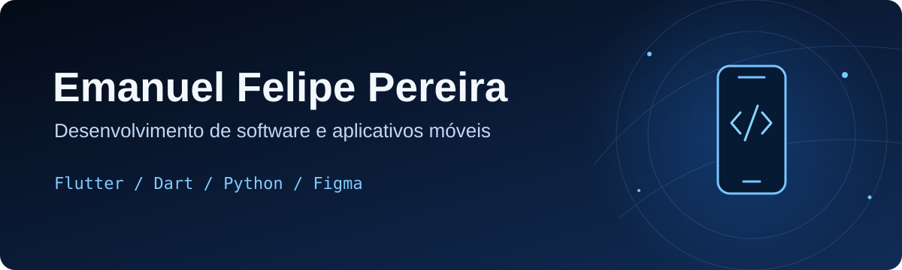

  

  

Olá! Sou Emanuel, estudante do técnico em Desenvolvimento de Sistemas no SENAI. Gosto de transformar ideias em aplicações e desenvolver experiências para web e dispositivos móveis.

> 🏆 **1º lugar na primeira etapa da seletiva escolar da WorldSkills**, na modalidade Desenvolvimento de Aplicativos Móveis.
>
> Durante minha preparação, trabalhei no projeto-teste Aprender+, com aplicativos Android em Flutter e interfaces no Figma.

## Projetos em destaque

Os quatro módulos abaixo fazem parte da minha preparação para a WorldSkills. **Os repositórios estão privados no momento**, então os links ficam disponíveis apenas para quem tem acesso.

**[Aprender+ A1 — jogos educativos](https://github.com/emanuelfelipehub/aprender-mais-a1-flutter)** · Flutter e Dart  
Aplicativo Android com quiz, jogos de memória, pontuação e integração com recursos do aparelho.

**[Aprender+ B1 — design de interfaces](https://github.com/emanuelfelipehub/aprender-mais-b1-design)** · Figma  
Projeto de interface para um aplicativo educacional, baseado nos desafios do módulo B1.

**[Aprender+ B2 — design de interfaces](https://github.com/emanuelfelipehub/aprender-mais-b2-design)** · Figma  
Projeto de interface para explorar cursos, agenda e perfil no contexto do módulo B2.

**[Aprender+ C1 — artigos e resumos](https://github.com/emanuelfelipehub/aprender-mais-c1-flutter)** · Flutter e Dart  
Aplicativo Android de estudo com artigos, vídeo e gravação de resumos em áudio.

## Tecnologias e aprendizado

  

Também estudo bancos de dados e fundamentos de segurança cibernética.

## Vamos nos conectar

Obrigado pela visita!

