  

Olá! Sou Emanuel, estudante do técnico em Desenvolvimento de Sistemas no SENAI. Gosto de transformar ideias em aplicações e venho desenvolvendo projetos para web e dispositivos móveis.

Na **WorldSkills**, fui aprovado na primeira etapa da seletiva escolar de Desenvolvimento de Aplicativos Móveis. Durante a preparação, trabalhei no Aprender+, com aplicativos Android em Flutter e interfaces no Figma.

### O que estou explorando

- **Mobile:** Flutter, Dart e recursos do Android.
- **Web e sistemas:** Python, HTML, CSS, JavaScript e bancos de dados.
- **Design e aprendizado:** Figma, experiência de uso e fundamentos de segurança cibernética.

  

### Projetos em destaque

**[Gestão de Frota e Manutenção](https://github.com/emanuelfelipehub/sistema-gestao-frota)** 
Sistema web em Python e Django para acompanhar veículos, manutenções e estoque de peças.

**[Sistema de Gestão Empresarial](https://github.com/emanuelfelipehub/sistema_empresa_web)** 
Aplicação em Flask para gerenciar cadastros e relacionamentos de uma empresa.

**[Agro Mec](https://github.com/emanuelfelipehub/Agro_Mec)** 
Projeto disponível no meu portfólio de desenvolvimento web.

Os projetos de treino **Aprender+** também estão no meu GitHub e, por enquanto, são privados.

### Minha atividade no GitHub

  
  

### Vamos nos conectar

Obrigado pela visita!
