

  

  

  
  
  
  
  
  



  


  
  
  


  

  


  

  <a href="https://github.com/emanuelfelipehub/aprender-mais-a1-flutter"></a>
  <a href="https://github.com/emanuelfelipehub/aprender-mais-b1-design"></a>
  <a href="https://github.com/emanuelfelipehub/aprender-mais-b2-design"></a>
  <a href="https://github.com/emanuelfelipehub/aprender-mais-c1-flutter"></a>


  <a href="https://github.com/emanuelfelipehub/Agro_Mec"></a>
  <a href="https://github.com/emanuelfelipehub/sistema-gestao-frota"></a>
  <a href="https://github.com/emanuelfelipehub/sistema_empresa_web"></a>


  

  


